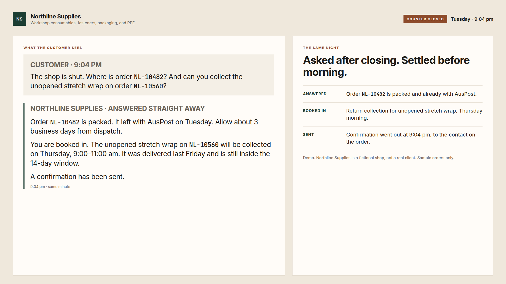
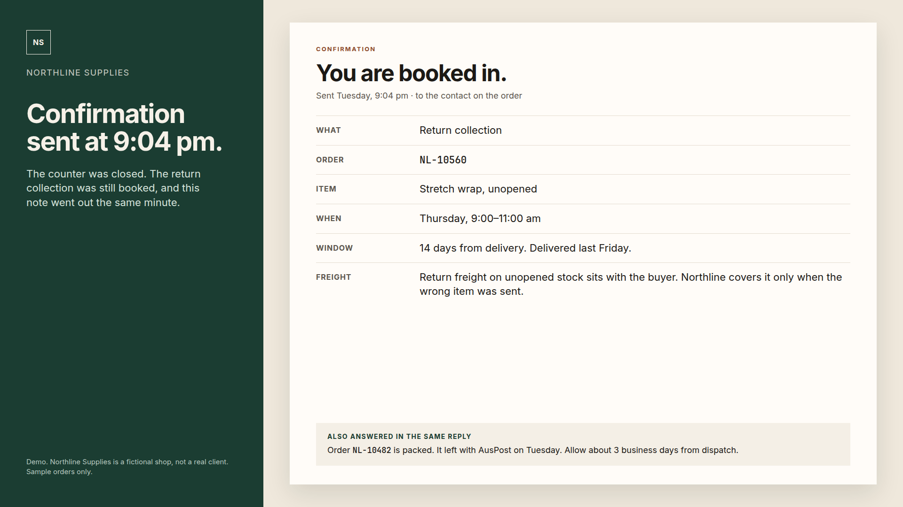
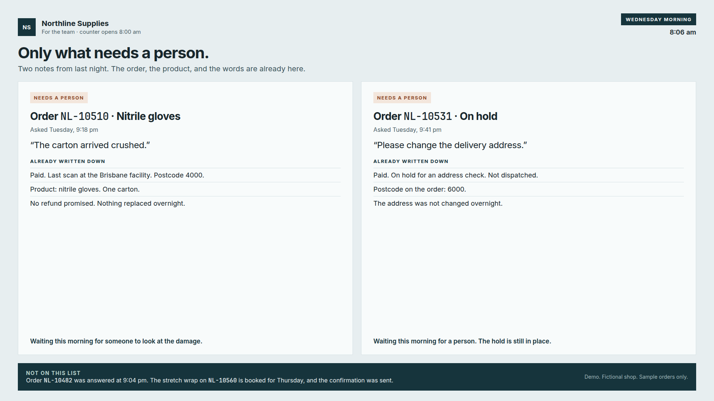

# A customer asks at 9pm

Northline Supplies is an Australian shop that sells workshop consumables, fasteners, packaging, and PPE.

Crom Services, Australia.

## The problem

It is 9pm on Tuesday. The counter is closed until 8am. A customer writes in anyway.

Where is order NL-10482? And can the unopened stretch wrap on order NL-10560 be collected?

These are the questions that already fill the morning: order status, shipping, and returns. The reply used to wait until someone was back at the counter. The customer sat with it all night, and the team opened to a pile of messages that were mostly the same.

## What happens

The question is answered at 9:04 pm, the same minute it arrives.

Order NL-10482 is packed. It left with AusPost on Tuesday. Allow about 3 business days from dispatch.

The customer is booked in. The unopened stretch wrap on NL-10560 was delivered last Friday and is still inside the 14-day window. Collection is Thursday, 9:00–11:00 am. Return freight on unopened stock sits with the buyer. Northline covers that freight only when the wrong item was sent.

A confirmation is sent at 9:04 pm, to the contact on the order.

The fix, in plain words:

1. A common question asked after closing is answered the same night.
2. A straightforward booking, such as this return collection, is made while the counter is shut.
3. A confirmation goes to the contact on the order before morning.
4. Anything that needs a person is held, with the order, the product, and the customer's words already written down.

## What's handed to staff

On Wednesday at 8:06 am the team does not reopen every message from the night. They see only what needs a person. The details are already there.

Two notes are waiting.

- **Order NL-10510, nitrile gloves.** At 9:18 pm the customer wrote that the carton arrived crushed. The order was paid. The last scan was the Brisbane facility, postcode 4000. No refund was promised, and nothing was replaced overnight.
- **Order NL-10531.** At 9:41 pm the customer asked for a new delivery address. The order is paid, on hold for an address check, and not dispatched. Postcode 6000. The address was not changed overnight.

The 9:04 pm question is not on that list. The status was given, the collection was booked, and the confirmation went out.

## What worked and what didn't

What worked: the customer was not left until morning for a status and a collection time. The answer, the booking, and the confirmation all happened at 9:04 pm. The team opened to two notes, not the whole night.

What didn't: unusual requests still wait for a person the next morning. A crushed carton, a refund, or a change of address is not decided at 9pm. The customer is told it is waiting for the team. Nothing is promised overnight.

## Next steps

This page is one evening at one fictional shop, so the shape is easy to see.

A shop with the same morning pile — where is the order, when does it arrive, can this unopened item come back — can compare a closed evening with the counter the next day. Ordinary questions should already be answered, booked, and confirmed. The team should open to the few that need them: damage, a refund, a change to the order.

Other packs: https://cromservices.github.io/job-page-sample/packs/

---

Crom Services · Australia · cromservices@gmail.com

Site: https://cromservices.com.au · Packs: https://cromservices.github.io/job-page-sample/packs/

<a href="https://cromservices.com.au"><picture><source media="(prefers-color-scheme: dark)" srcset="https://cromservices.com.au/brand/credit/crom-credit-lockup-dark@2x.png"></picture></a>
